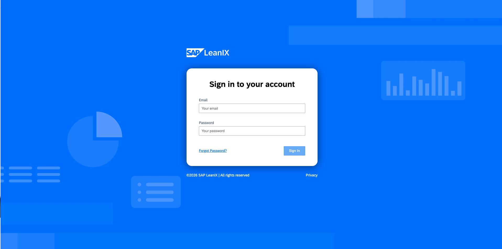
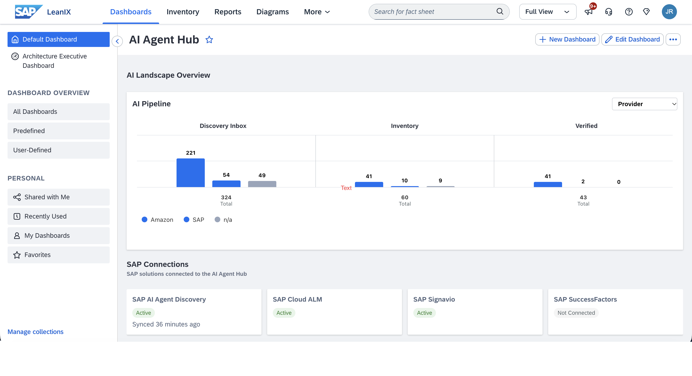

# Getting Started

## Overview

Before the exercises begin, log in to SAP LeanIX and take a few minutes to orient yourself in the AI Agent Hub interface.

> [!IMPORTANT]
> **System access and credentials 🔐**
>
> This workshop uses a single shared SAP LeanIX workspace. Your trainer will share the password at the start of the session.
>
> | System | URL | Credentials |
> |--------|-----|-------------|
> | SAP LeanIX — AI Agent Hub | [https://url.sap/u5vhev](https://url.sap/u5vhev) | User **BT161-0NN** (your participant number); password shared at the start of the session |
>
> **Your participant number**
>
> Every participant has a personal AI agent pre-loaded in the Discovery Inbox. The agent is named after your participant number so you can find it instantly in the shared workspace.
>
> 👉 Note your participant number — it is the two-digit suffix of your user, in the form **BT161-0NN** (for example, BT161-007, where your number is 07). You will reuse it throughout all exercises.

> [!TIP]
> Whenever an exercise asks you to search for your agent, use your participant number. In a shared workspace it is the quickest way to tell your agent apart from everyone else's.

## Step 1 — Log In to SAP LeanIX

1. Open your browser and navigate to **[https://url.sap/u5vhev](https://url.sap/u5vhev)**.

   

2. Sign in with your **BT161-0NN** user and the password shared at the start of the session.
3. You should land on the **SAP LeanIX home screen**. Open the **AI Agent Hub** using the direct link on your session card — it points to `https://de-6.leanix.net/trainingsystemarchitects/dashboard/ai-agent-hub-v2`. The AI Agent Hub is part of the Dashboards section and this is where all the exercises take place.

## Step 2 — Locate Your Participant Number

Your user name includes your **participant number** — the two-digit suffix of **BT161-0NN** (for example, if your user is BT161-007, your number is 07). You will use this number throughout the workshop to identify your personal agent in the shared workspace — every participant has a uniquely named agent pre-loaded in the Discovery Inbox.

## Step 3 — Quick Orientation in SAP LeanIX

Spend two minutes exploring the AI Agent Hub interface:

- The **Dashboard** is your starting point — it gives you a real-time view of your AI governance posture.
- The **Inventory** shows all agents, MCP servers, and LLMs known to the system — SAP standard, custom, and third-party.
- The **AI Agent Discovery Inbox** surfaces governance actions that need your attention — new discoveries, pending reviews, and alerts. Navigate to it via: *Inventory → Inventory Tools (top right) → Discovery Inbox → AI Agent Discovery*
- The **Enterprise Architecture Assistant** is available throughout the session. It is a conversational AI solution that helps you research and analyze your enterprise architecture data using natural language directly in your workspace.

   

> **Do not make any changes yet.** Exercise 1 starts from the Dashboard.

[Next: Exercise 1 — The AI Agent Hub Dashboard](../ex1/README.md)
