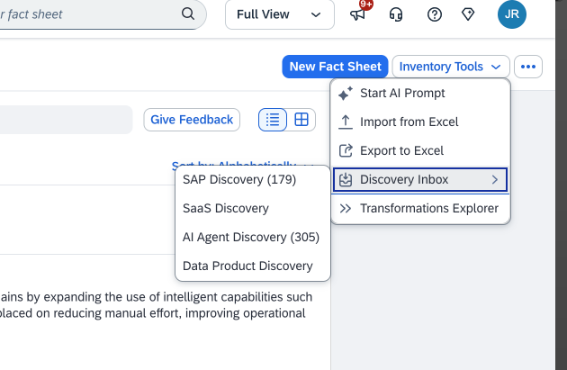
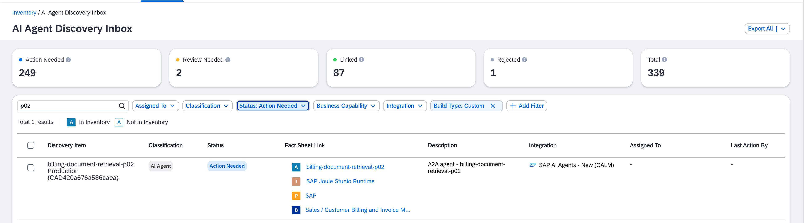
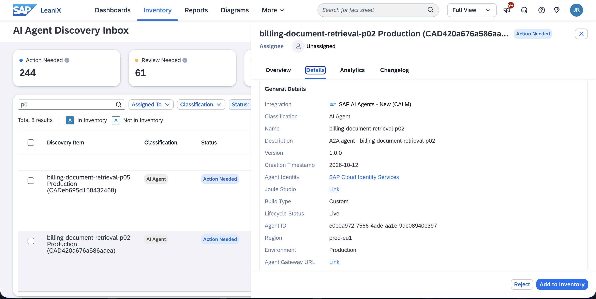

# Exercise 2 — From Discovery to Inventory

## Overview

Your agent is waiting in the Discovery Inbox. In this exercise you will open it, review the discovery details, and add your agent to the governed inventory.

## Background

The AI Agent Discovery Inbox is where AI Agent Hub surfaces everything it has found. Agents arrive here from connected systems: standard SAP agents provisioned via SAP for Me, custom agents deployed by teams in your organization on Joule Studio, and third-party agents discovered from platforms such as Microsoft Entra ID, Google Cloud, AWS Bedrock, and ServiceNow. All agents, regardless of origin, go through the same review-and-approve process before entering the governed inventory. For a full list of supported discovery integrations, see [AI Agent Discovery](https://help.sap.com/docs/LEANIX/72d375467c1e4dcb872dfa2998b6328d/cd40550e6bc64547a0915446e108a472.html) in the SAP Help Portal.

Your agent was pre-loaded for this workshop to simulate a real discovery event: the EA team at GlobalFlex AG has no prior record of it, and it is your job to evaluate whether it belongs in the governed inventory.

## Step 1 — Open the AI Agent Discovery Inbox

1. In SAP LeanIX, navigate to:
   **Inventory → Inventory Tools *(top right)* → Discovery Inbox → AI Agent Discovery**

   

2. Apply the filter **Status: Action Needed** to focus on unreviewed agents.
3. Add the **Build Type** filter via the **Add Filter** button, then select **Custom** to narrow the list to agents built by teams in your organization.
4. Search for your participant number (e.g., *P07*) to find your agent.

   

## Step 2 — Review the Overview

Open your discovery item. The **Overview** panel shows what AI Agent Hub has automatically collected:

| Field | What you are seeing |
|-------|---------------------|
| **Description** | What the agent claims to do — sourced from the system where it was discovered |
| **Creation Timestamp** | When this agent first appeared in the landscape |
| **Build Type** | Custom — built and deployed by a team in your organization |
| **Discovered Fact Sheets** | Automatically suggested related fact sheets — including the **IT component** (Joule Studio runtime) and **provider** (SAP), as well as any **MCP servers** the agent uses |
| **Additional Suggestions** | Other related fact sheets the system thinks may be relevant — often includes **business capabilities** |

Read through the details. Treat yourself as an EA team member seeing this agent for the first time.

## Step 3 — Check the Details Page

Click **Show all details** to open the full discovery record. Here you will find:

- **Region** — where the agent is deployed
- **Environment** — whether this agent is running in a **productive** environment or a development/test environment
- **Joule Studio link** — opens the agent project in Joule Studio. Note: as an EA team member you may not have access to Joule Studio directly — this link is primarily for the developer who built the agent.
- **Cloud Identity Services link** — shows the agent's identity record. This confirms the agent has a registered identity, which means authentication, access policies, and user authorizations can be managed there.

> **Why this matters:** A productive environment means real users are already interacting with this agent — potentially with access to live SAP S/4HANA data — before any governance review has taken place.

## Step 4 — Add to Inventory

1. Return to the discovery item and click **Add to Inventory**.
2. The agent is now part of the governed inventory — status changes to **Unverified**.
3. Open the newly created fact sheet by hovering over the fact sheet link and clicking through.

> **Note:** The person who deployed this agent is automatically assigned as **Responsible** subscriber — this is pulled from the deployment metadata. The EA team's role here is Observer, which you will set in Exercise 3.

## Summary

Your agent is now in the inventory with a governance record started. In Exercise 3, you will complete the parts of the governance profile the EA team can fill in independently.

[Back: Exercise 1](../ex1/README.md) | [Next: Exercise 3 — Complete the Governance Profile](../ex3/README.md)
