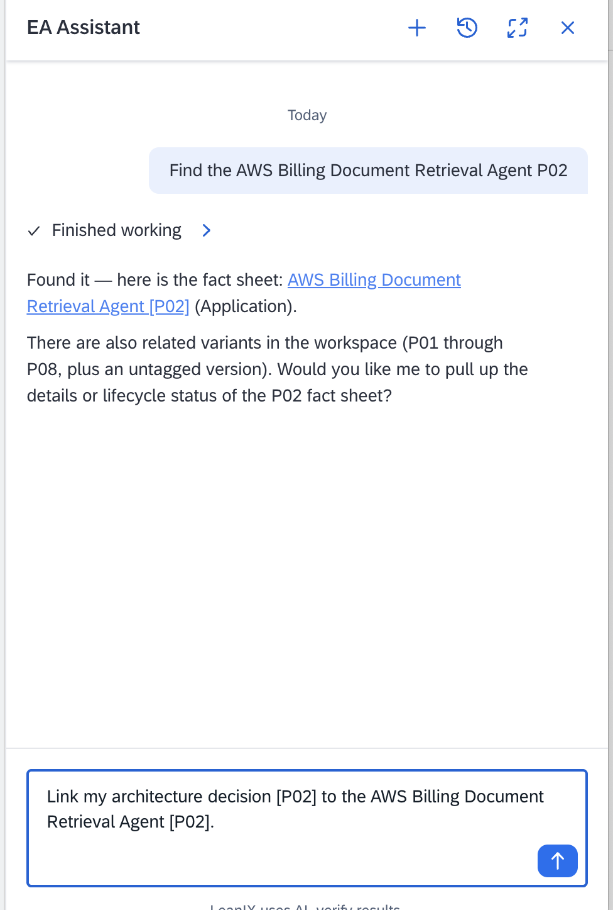
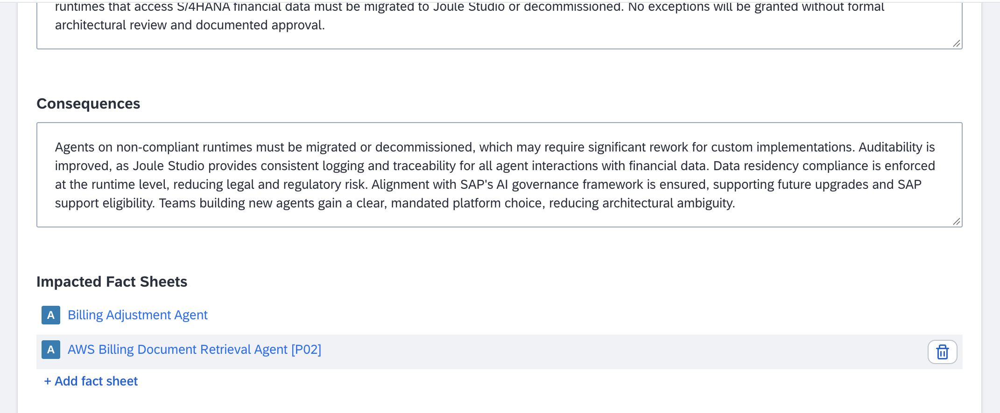
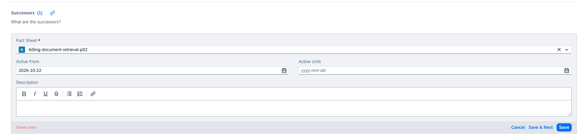
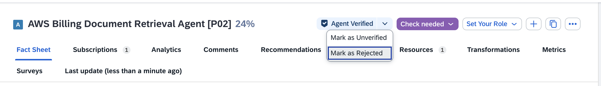

# Exercise 6 — Decommission a Legacy Agent

## Overview

Governance is not only about approving new agents — it also means formally closing out agents that are no longer needed. In this exercise you will decommission a legacy billing agent that has been replaced by the one you just verified, documenting the lineage and removing its production approval.

## Background

The custom Joule Studio agent you governed in Exercises 2–5 was introduced to replace an older agent: the **AWS Billing Document Retrieval Agent [PXX]**, a legacy billing agent built on AWS Bedrock by the Finance Controlling team in 2023 to automate billing document lookups and retrievals for GlobalFlex AG's Quote-to-Cash process (searching for billing documents, checking billing dates, retrieving posting information, and updating billing references via custom REST API endpoints into SAP S/4HANA). It was a valid solution at the time — but it runs on AWS infrastructure outside SAP's security perimeter, and it was built before the Joule Studio runtime policy was established.

The AWS Billing Document Retrieval Agent [PXX] is already in **Phase Out** lifecycle — but the governance record has not been closed out. Without formal decommissioning, it could still be discovered, reactivated, or mistaken for an active agent.

Your job is to complete the record: link the governing architecture decision, link the successor, update the lifecycle to End of Life, and remove the verification.

## Step 1 — Find the Legacy Agent

1. Navigate to **More** (top header) → **EA Assistant**.
2. Use the following prompt:

   > *"Find the AWS Billing Document Retrieval Agent [PXX]."*

3. Open the fact sheet returned by the assistant.

## Step 2 — Link the Architecture Decision

The ADR you created in Exercise 1 — "Finance Agents on SAP S/4HANA Must Use Joule Studio Runtime" — is exactly why this agent is being retired. The AWS Billing Document Retrieval Agent [PXX] runs on AWS Bedrock rather than the Joule Studio runtime, so it does not comply with the policy. Linking the ADR here closes the governance loop: the decision that triggered the decommissioning is traceable from the agent's fact sheet.

You can do this in two ways — choose one:

**Option A — via EA Assistant** (continuing the session from Step 1):

> *"Link my architecture decision [PXX] to the AWS Billing Document Retrieval Agent [PXX]."*

   

**Option B — from the ADR fact sheet:**

1. Navigate to your ADR ("Finance Agents on SAP S/4HANA Must Use Joule Studio Runtime — [PXX]").
2. In the **Affected Fact Sheets** section, add the **AWS Billing Document Retrieval Agent [PXX]**.

   

## Step 3 — Set the Successor

Document that your newly verified Joule Studio agent replaces this one.

1. In the fact sheet, scroll to the **Information** section. Under **Relationship Explorer**, find the **Successors** subsection. 
2. Add your verified custom agent as the successor (search for your participant number `[PXX]`).
3. Set an **Active From** date matching the **Active** date you set on your custom agent in Exercise 5. This records when the successor took over.

   

> **Why this matters:** Setting the successor creates a formal lineage record. Anyone looking at this legacy agent in the future will see exactly what replaced it — and when. The successor agent's fact sheet will show the legacy agent as its **Predecessor**.

## Step 4 — Update the Lifecycle to End of Life

1. In the fact sheet header, open the **Lifecycle** field.
2. Set the **End of Life** phase with today's date.

> The lifecycle field is date-driven, so set the actual **End of Life date** — not just the phase label. This records *when* the agent was retired, which is what drives lifecycle and roadmap reports and the Change Log timestamp. This mirrors the **Active** phase you opened in Exercise 5: you are now closing the lifecycle you started.

## Step 5 — Reject the Verification

An End of Life agent should not carry a production-approved verification badge. For agents being decommissioned, the correct action is to explicitly reject rather than simply unverify — this records a deliberate governance decision, not just a neutral reset.

1. Locate the **Verification Badge** at the top of the fact sheet header.
2. Click the badge and select **Mark as Rejected**.

   

The badge updates to reflect the rejected state — the agent is formally recorded as no longer approved for production use.

## Summary

You have completed the full governance lifecycle — from discovering a new agent all the way to formally decommissioning a legacy one. The ADR links the policy decision that drove the retirement; the successor link connects the two agents as a documented lineage; and the decommissioning record is preserved in the Last Updated tab. The legacy agent remains in the inventory as a historical record; it is not deleted. (In a real landscape you would typically **archive** the fact sheet after a retention period, which removes it from active views while keeping its history.)

> This is what the session title means by "from discovery to decommissioning" — governance is a continuous cycle, not a one-time event.

## Going Further — Decommissioning at Portfolio Scale

In this exercise you decommissioned one agent by editing its fact sheet directly — the right approach for a single, already-decided retirement. When you need to *plan* decommissioning across many agents or applications, SAP LeanIX offers a more powerful path: **Architecture and Road Map Planning** (formerly the Business Transformation Module). You model the retirement as a **Decommission** transformation tied to an initiative, preview the impact before applying it, visualize the sunset on a roadmap, and update the inventory with one click when the change happens.

This is an advanced capability beyond the scope of today's beginner workshop, but worth knowing it exists:

- [Target Architecture Planning](https://help.sap.com/docs/LEANIX/72d375467c1e4dcb872dfa2998b6328d/716633e9efed4de4a269ae0dce7df544.html?locale=en-US) — add transformations such as decommissioning an application and preview the impact
- [Create AI-Related Transformations](https://help.sap.com/docs/LEANIX/72d375467c1e4dcb872dfa2998b6328d/275d58c37a441014962be776bd832558.html?locale=en-US) — plan AI agent and IT component changes on a transformation roadmap
- [SAP LeanIX Architecture and Road Map Planning](https://help.sap.com/docs/LEANIX/72d375467c1e4dcb872dfa2998b6328d/2758bc147a441014b210c1a6641458da.html?locale=en-US) — overview of predefined transformations and roadmaps

[Back: Exercise 5](../ex5/README.md) | [Return to Overview](../../README.md)
